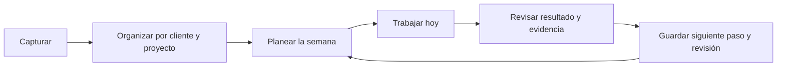

# GX1 Dashboard — propuesta funcional v0.1

10 de noviembre de 2026 · Planeación para revisión · Aplicación aún no implementada

## 1. Resultado que debe producir

Abrir el dashboard y responder: **qué hago hoy, por qué importa, cómo lo hago y dónde me quedé**. Al terminar, dejar registrado el resultado y el siguiente paso. El objetivo es sacar los pendientes de la memoria y del chat de WhatsApp, conservar el contexto y dar continuidad al trabajo.

Confirmado por Gabriel: uso personal inicial; Ecopests, Caycer, RP Carpintería y GX1 como áreas de trabajo; contenido, webs/sistemas y seguimiento recurrente; prioridad en ejecución diaria y planeación; exploración mediante imágenes antes de programar. Todo lo que sigue es una propuesta de comportamiento, no una funcionalidad ya disponible ni un compromiso operativo real.

## 2. Estructura sencilla

| Lugar | Para qué sirve | Acción principal |
| --- | --- | --- |
| **Hoy** | Decidir y ejecutar el trabajo del día; ver pendientes por organizar, entregas cercanas y revisiones vencidas | Elegir prioridades y retomar una tarea |
| **Clientes** | Abrir el contexto completo de un cliente, incluido GX1 | Revisar proyectos y elegir el siguiente paso |
| **Plan** | Distribuir trabajo en la semana y revisar capacidad | Programar tareas y rutinas |
| **Biblioteca** | Encontrar archivos, enlaces y procedimientos de todos los clientes | Buscar y abrir el material correcto |

**Capturar pendiente** siempre disponible. Basta un título; cliente y fecha son opcionales al capturar. Lo incompleto va a **Por organizar**, dentro de Hoy. Búsqueda global por título, cliente, proyecto y nombre de archivo. Ajustes y cuenta fuera de la navegación principal de trabajo.

No duplicar información: Hoy, Plan y Clientes muestran las mismas tareas con diferentes filtros. Biblioteca muestra los mismos materiales que aparecen dentro de un proyecto.

## 3. La pantalla Hoy

Orden propuesto:

1. **Mis prioridades:** selección manual sugerida de hasta tres tareas; el usuario puede cambiarla. Acción visible: «Retomar».
2. **Agenda del día:** trabajo programado y revisiones que corresponden hoy.
3. **Requiere atención:** vencimientos, bloqueos con seguimiento pendiente y proyectos sin siguiente acción. Cada aviso explica el motivo y ofrece una acción.
4. **Por organizar:** capturas rápidas sin cliente/proyecto o sin decisión de qué hacer con ellas.

El detalle de una tarea se abre en un panel para conservar el lugar en la lista; en móvil ocupa una pantalla. Muestra objetivo, pasos, criterio de terminado, materiales, último avance y siguiente acción.

Separar **fecha para trabajar** y **fecha de entrega**. Una tarea puede estar planeada para el martes y vencer el viernes. Si se pasa la fecha planeada, se ofrece reprogramar; la fecha prometida no cambia sola.

Los avisos son verificables: «Revisión pendiente desde el lunes» o «No tiene siguiente paso». No presentar porcentajes de productividad ni declarar que un cliente está al día por haber abierto su ficha.

## 4. Cada cliente conserva su contexto

Ficha con cuatro pestañas:

- **Resumen:** objetivo actual, entrega próxima, último avance, siguiente paso y próxima revisión.
- **Trabajo:** proyectos y tareas, con lista por defecto y tablero opcional más adelante.
- **Materiales:** archivos y enlaces con proyecto, versión y estado de revisión.
- **Historial:** decisiones, avances, revisiones y entregas, ordenados por fecha.

Dentro de Trabajo, agrupar por **Contenido**, **Webs y sistemas** y **Seguimiento** cuando haya datos; son categorías, no tres módulos con información repetida. GX1 usa la misma estructura y puede recibir prioridades semanales para que su trabajo no desaparezca detrás de los clientes.

Un proyecto tiene objetivo, resultado esperado, tareas, recursos, notas de continuidad y fecha de próxima revisión. Un sistema puede enlazar su sitio, repositorio y panel de administración, y guardar una revisión manual con fecha y evidencia. Guardar un enlace no significa que el sistema esté conectado o monitoreado automáticamente.

## 5. Flujo de trabajo y continuidad

Estados iniciales de tarea: **Por hacer → En curso → En revisión → Hecho**. **En espera** está disponible desde cualquier estado abierto y requiere motivo; la fecha de seguimiento es opcional pero se recomienda. Volver a trabajar y reabrir una tarea terminada son acciones explícitas que conservan el historial.

Una tarea sencilla puede terminarse directamente. Una entrega marcada como revisable pasa por En revisión: se registra qué se verificó, el resultado y el archivo/enlace de evidencia cuando aplique. Subir un archivo no termina la tarea automáticamente. Si requiere cambios, vuelve a En curso conservando la revisión y la versión anterior.

Al terminar una sesión de trabajo, ofrecer tres campos breves:

- **Avancé en…**
- **Lo siguiente es…**
- **Retomar/revisar el…**

No obligar a completar una bitácora larga en cada acción. Al cerrar una tarea, el proyecto activo debe conservar otra acción o una revisión futura; si no existe, mostrarlo en Requiere atención. Un proyecto cerrado o pausado no genera avisos diarios de falta de actividad.

## 6. Plan semanal y procesos recurrentes

El Plan muestra la semana, los compromisos, la disponibilidad que Gabriel decida registrar y una lista de trabajo sin programar. Las estimaciones de duración son opcionales; sin ellas no se inventa una carga horaria precisa.

Mover una tarea entre días no duplica la tarea. Los cambios se pueden hacer con botones y teclado, además de arrastrar. Mostrar cuándo un día excede la capacidad registrada; nunca reordenar compromisos silenciosamente.

Una **rutina** es una plantilla con frecuencia, checklist y criterio de terminado: por ejemplo revisión de un sistema, preparación de contenido o cierre semanal. Los ejemplos no son obligaciones confirmadas de ningún cliente.

Primera versión: frecuencia semanal o mensual; una ocurrencia identificada por rutina y fecha. Reintentar o recargar no puede crear duplicados. Las ocurrencias vencidas conservan su fecha hasta completarse, reprogramarse u omitirse con motivo. Cambiar una plantilla afecta el futuro, no altera el historial. Pausar un cliente suspende la generación futura, con el trabajo abierto visible para decidir qué hacer con él.

Ritmo de uso propuesto, ajustable tras probarlo:

- **Inicio del día, 5 minutos:** organizar capturas, revisar compromisos y elegir prioridades.
- **Durante el trabajo:** capturar ideas y registrar avances desde la misma tarea.
- **Cierre, 3 minutos:** dejar el siguiente paso y revisar lo pendiente.
- **Revisión semanal, 20 minutos:** recorrer las cuatro áreas, comprobar entregas, resolver bloqueos y preparar la siguiente semana.

Estas duraciones son objetivos de experiencia, no tiempos medidos ni recordatorios ya programados.

## 7. Materiales y verificación

Adjuntar inicialmente documentos, imágenes y enlaces; los originales pesados de video pueden conservarse en su proveedor actual con un enlace. Decidir tipos y límites reales antes de implementar la carga. Cada material pertenece a un cliente y, cuando corresponde, a un proyecto/tarea.

Datos mínimos: nombre, ubicación, fecha, versión y estado (borrador, por revisar, validado o sustituido). Subir una revisión crea una versión nueva, no sobrescribe silenciosamente el archivo anterior. La revisión apunta a una versión concreta; reemplazarla no hereda una validación anterior.

Mostrar progreso, fallo y reintento de carga. Un enlace externo puede caducar o perder permisos; permitir corregirlo sin perder su historial. La búsqueda inicial cubre metadatos, no promete leer el contenido de PDFs o videos. La biblioteca incluye procedimientos reutilizables con pasos y checklist para explicar **cómo hacerlo**.

## 8. Incorporar el trabajo que ya existe

1. Crear las cuatro áreas, sin inventar fechas, entregables ni estados actuales.
2. Pegar manualmente los pendientes elegidos del chat en Por organizar. Proponer una captura por línea y revisar antes de guardar; no conectar ni enviar mensajes de WhatsApp en esta fase.
3. Para cada pendiente, decidir cliente, proyecto, siguiente acción y compromiso real si existe.
4. Añadir los enlaces o archivos que permitan retomar el trabajo más próximo.
5. Dar a cada proyecto activo una siguiente acción o fecha de revisión.
6. Usar el sistema durante una semana y ajustar los campos que estorben antes de ampliar funciones.

Los nombres de clientes están confirmados. El contenido comercial del sitio puede ayudar a reconocer proyectos, pero no se importará como lista de tareas ni como estado actual sin revisar.

## 9. Primera versión y crecimiento

| Etapa | Entrega | Condición para darla por lista |
| --- | --- | --- |
| A. Diseño | Imágenes de Hoy, cliente/proyecto y Plan; elegir la estructura antes de programar | Se entiende cómo capturar, priorizar y retomar sin explicación adicional |
| B. Base utilizable | Acceso personal, cuatro áreas, proyectos, captura, tareas, Hoy, Plan y continuidad guardados en servidor | Cerrar y abrir la sesión conserva todo; completar el recorrido con datos de prueba |
| C. Continuidad completa | Rutinas, revisiones, biblioteca, cargas privadas/versiones y plantillas | Una rutina reaparece sin duplicarse y una entrega conserva evidencia de revisión |
| D. Uso real | Incorporación controlada de pendientes y revisión semanal | Cada proyecto activo tiene siguiente acción o revisión y los materiales se encuentran con facilidad |

B y C conforman la primera versión acordada en alcance funcional. B es un punto de prueba intermedio, no reemplaza la necesidad de archivos y recurrencias.

Después de validar el uso: integraciones de calendario/Drive/GitHub, asistente para sugerir planes, notificaciones y portal de clientes si se solicitan. Facturación, CRM comercial, chat interno, automatización de publicaciones y monitoreo técnico automático quedan fuera de esta primera versión.

## 10. Integración con GX1

Hallazgos del repositorio: aplicación en `web/`, Next.js 16.2.10, React 19.2.4, TypeScript y Tailwind 4. `web/src/app/layout.tsx` monta actualmente la navegación pública, footer, WhatsApp, cursor y desplazamiento animado para todas las rutas. No se encontró autenticación, persistencia de tareas ni dashboard.

Propuesta:

- Mantener el mismo repositorio y app. Ruta privada `/dashboard`; acceso en `/login`.
- Dejar el layout raíz con fuentes y elementos compartidos. Colocar el shell de marketing en un grupo de rutas público y el shell de trabajo en otro. Los grupos permiten organizar layouts sin cambiar las URLs públicas; verificar las rutas y metadatos tras moverlas. Véase la documentación de [Route Groups](https://nextjs.org/docs/app/api-reference/file-conventions/route-groups).
- Preservar logo, familia tipográfica y acento de GX1. Para operar, usar listas legibles, controles consistentes, estados claros y movimiento breve. La composición visual se decide con imágenes; no hay un diseño aprobado todavía.
- Usar navegación y cursor estándar en el dashboard. Su uso continuo exige que los controles respondan de inmediato.
- Autorización del lado del servidor en cada lectura/escritura, además del acceso a las páginas. La guía de [autenticación de Next.js](https://nextjs.org/docs/app/guides/authentication) recomienda validar cerca de los datos.
- **Opción técnica propuesta, no contratada:** Supabase para identidad, Postgres y archivos privados. Sus políticas [RLS](https://supabase.com/docs/guides/database/postgres/row-level-security) permiten restringir filas; los [buckets privados](https://supabase.com/docs/guides/storage/buckets/fundamentals) requieren acceso autorizado o enlaces temporales. La elección depende de las cuentas disponibles y el volumen de archivos.
- Solo la identidad de Gabriel estará autorizada al inicio. Iniciar sesión por sí solo no habilita a cualquier otra cuenta.
- El repositorio es público: código, migraciones y documentación técnica en GitHub; datos operativos y materiales en almacenamiento privado. No guardar datos reales en `public/`, seeds o pruebas. No usar localStorage como base principal.
- No indexar dashboard/login ni incluirlos en el sitemap; esto complementa el acceso privado, no lo sustituye.
- Fechas de trabajo en `America/Mexico_City`; distinguir fechas sin hora y eventos con timestamp para evitar desplazamientos de día.
- Versionar migraciones y definir exportación/respaldo y una restauración de prueba antes de depender diariamente del sistema.

Modelo inicial de información: cliente → proyectos → tareas; notas/avances y revisiones asociados; materiales con versiones; rutinas con ocurrencias; planificación diaria/semanal que referencia tareas. Todos los registros privados pertenecen al usuario autorizado. La planificación no crea una segunda copia de las tareas.

Desarrollo mediante ramas y pull requests con avances revisables. Usar previews para probar cada etapa; integrar a producción tras verificar flujos y regresiones. La configuración exacta del proyecto Vercel y su vínculo activo con GitHub aún no se verificaron: la herramienta solicitó autenticación repetidamente. No afirmar que los pushes ya generan un despliegue comprobado.

## 11. Validación de la primera versión

- Capturar un pendiente con solo un título y organizarlo posteriormente.
- Encontrar el último avance y la siguiente acción de un proyecto sin consultar otro chat.
- Ver una tarea actualizada de forma consistente en Hoy, Cliente y Plan, también tras recargar.
- Distinguir programación de trabajo, entrega, bloqueo y revisión pendiente.
- Completar, reabrir y revisar sin perder notas ni versiones.
- Crear la siguiente ocurrencia de una rutina exactamente una vez, conservando las vencidas.
- Subir, abrir y recuperar una versión anterior de un archivo privado; probar también una carga fallida.
- Rechazar acceso a páginas, operaciones y archivos desde una sesión anónima o una cuenta no autorizada.
- Explicar estados de vacío, guardando, guardado, error, sesión vencida y conflicto entre pestañas. No mostrar éxito si el servidor no confirmó el guardado.
- Poder usarlo en escritorio y móvil, con teclado, foco visible, contraste AA y controles táctiles accesibles.
- Confirmar que inicio, servicios, contacto y metadatos públicos mantienen su funcionamiento.

## 12. Decisiones que faltan

Antes del prototipo: elegir composición de Hoy y ficha de cliente mediante imágenes, siguiendo la preferencia confirmada. Antes de incorporar datos reales: inventario breve de pendientes y archivos, identidad de acceso, proveedor de persistencia, límites de carga y cadencias reales por cliente. Se pueden validar con un solo proyecto piloto antes de cargar todo.

Este documento es el punto de partida funcional. No representa una aprobación del diseño visual, una compra de servicios, una importación de conversaciones ni una publicación del dashboard.
